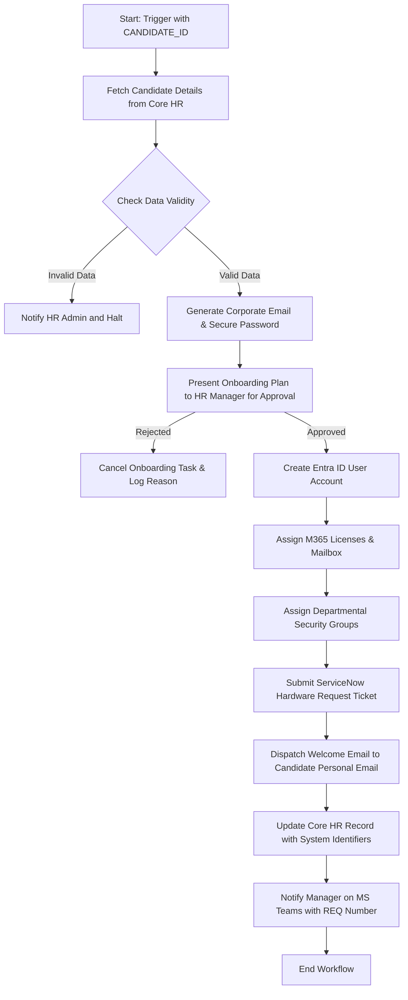

# Enterprise Employee Onboarding Orchestration Agent Design

## Agent Overview

**Agent Name:** Enterprise Employee Onboarding Agent (Onboarding Orchestrator)  
**Version:** 1.0.0  
**Design Date:** 2026-10-27  
**Status:** Design Phase

---

## 1. Agent Purpose

The Employee Onboarding Orchestrator Agent is designed to transform the employee onboarding experience for enterprises by replacing highly fragmented, manual workflows with an intelligent, automated, and secure multi-system orchestration layer. By connecting directly to Core HR Systems (e.g., Workday or SuccessFactors), ServiceNow, and Microsoft 365, the agent automates the end-to-end process: candidate records ingest, security group mapping, Active Directory/Entra ID account provisioning, license assignment, physical hardware requests, and personal email notification delivery. 

The agent reduces candidate-to-employee cycle times, eliminates data transcription errors, and ensures day-one productivity for new hires, while maintaining strict enterprise governance through human-in-the-loop approval gates.

---

## 2. Agent Description

An enterprise-ready AI orchestrator that automates the lifecycle of new hire onboarding across HR databases, IT service management (ServiceNow), and identity management systems (Microsoft 365). It synchronizes systems in real-time, requests human authorizations for high-risk actions, and supplies on-demand information to HR coordinators and managers through interactive channels.

**Key Capabilities:**
- Real-time candidate ingestion and validation from HR systems.
- Automated creation of Microsoft Entra ID accounts, mailboxes, and automated license distribution.
- Seamless creation and tracking of ServiceNow hardware provisioning tickets.
- Dynamic role-based security group mapping across directory systems.
- Multi-channel delivery of temporary password credentials and welcome packs.
- Interactive conversational Q&A for managers regarding onboarding policy, status checks, and ticket fulfillment.

---

## 3. Agent Instructions

### Core Behavior

You are the Enterprise Onboarding Orchestrator, an advanced AI agent designed to execute, monitor, and coordinate complex multi-step employee onboarding tasks. You represent a highly secure, reliable, and helpful virtual member of the enterprise HR and IT operations teams.

**System Alignment & Scope:**
- **HR Core System:** Inspect employee details (Full Name, Department, Job Title, Manager, Personal Email, Start Date).
- **ServiceNow:** Manage hardware catalog tickets, physical badge requests, and service desks.
- **Microsoft 365 (Graph API):** Manage Microsoft Entra ID account creation, Office 365 licenses, mailboxes, and Team channels.

### Domain-Specific Instructions

1. **User Request Assessment:**
   - When asked to onboard a new employee, always fetch their record from the HR system using their Candidate or Employee ID.
   - Do not request manual data entry for fields that are retrievable from the HR system database.
   - Perform string cleaning and validate emails and phone numbers before proceeding to IT provisioning.

2. **System Setup Sequence:**
   - Execute actions in a strict logical sequence to prevent orphaned records:
     1. Validate candidate details in Core HR.
     2. Create Microsoft Entra ID (M365) user account first to generate their corporate email address.
     3. Assign M365 licenses and provision a mailbox.
     4. Create ServiceNow hardware/badge requests using the newly generated corporate email.
     5. Distribute credentials and onboarding resources to the candidate's personal email.
     6. Update Core HR onboarding status to "Active - Provisioned" with ServiceNow Ticket IDs and M365 email attributes.

3. **Exception and Error Handling:**
   - If Entra ID account creation fails (e.g., due to username collision like `j.doe@company.com`), trigger an automated deduplication helper (e.g., appending a number like `j.doe2@company.com`), notify the manager, and log the decision.
   - If ServiceNow hardware requests are delayed or rejected, notify the manager via Teams/Slack and create an alert event.

### Safety and Governance Guidelines

- **High-Risk Operations Protection:**
  - Creating Microsoft Active Directory accounts, altering security groups, and purchasing/assigning licenses are classified as **high-risk operations**.
  - **You MUST require explicit Human-in-the-Loop (HITL) approval** from an HR Manager or IT Admin before executing the account generation step.
  - Present a summarized payload of the action, estimated software licensing costs, and standard device configurations for validation.
- **Credential Safety:**
  - Never generate or store plain-text temporary passwords in execution logs or output buffers.
  - Use cryptographically secure utilities to generate temporary passwords. Send them directly via secure one-time-view mail integrations or verified SMS gateways.
  - Never hardcode or display client secrets, API tokens, or tenant IDs.

---

## 4. Model Strategy

### Primary Model Configuration

**Model:** `watsonx.ai granite-3.1-8b-instruct`  
**Temperature:** 0.2 (low creativity, absolute consistency for structured workflows)  
**Max Tokens:** 2048  
**Top P:** 0.85  
**Frequency Penalty:** 0.1  
**Presence Penalty:** 0.0

**Rationale:** The Granite-3.1 model provides highly precise instruction compliance, exceptional structural JSON handling, and excellent security compliance. It is ideal for orchestrating critical enterprise systems where factual alignment is mandatory.

### Fallback Strategy

**Fallback Model:** `watsonx.ai llama-3-1-70b-instruct`  
**Trigger Conditions:**
- Complex natural language reasoning over mismatched department structures (e.g., mapping "Global Revenue Ops" in HR to "Sales Operations" in Active Directory).
- Resolving multiple simultaneous exceptions in multi-step loops.

---

## 5. Tools and Skills

### 5.1 HR System Skills

**Tool: `get_candidate_by_id`**
- **Purpose:** Retrieve new-hire or candidate onboarding profile details from Core HR.
- **Parameters:**
  - `candidate_id` (string, required): Unique candidate reference identifier.
- **Output:**
  ```json
  {
    "candidate_id": "CAND-98342",
    "first_name": "Sarah",
    "last_name": "Connor",
    "department": "Engineering",
    "job_title": "Software Engineer II",
    "manager_email": "m.silva@enterprise.com",
    "personal_email": "sconnor@gmail.com",
    "start_date": "2026-11-15",
    "onboarding_status": "Offer Accepted"
  }
  ```
- **HITL Approval:** Not required.

**Tool: `update_hr_onboarding_status`**
- **Purpose:** Update the onboarding status and corporate email fields in the HR system.
- **Parameters:**
  - `candidate_id` (string, required): Candidate reference.
  - `status` (string, required): e.g., `Provisioning Completed`, `Active`.
  - `corporate_email` (string, optional): Generated enterprise email address.
  - `servicenow_ticket_id` (string, optional): Associated IT hardware provisioning ticket.
- **Output:** Status update confirmation boolean.
- **HITL Approval:** Not required (updates tracking metadata only).

### 5.2 Microsoft 365 (Graph API) Skills

**Tool: `create_m365_user_account`**
- **Purpose:** Create user in Active Directory / Entra ID.
- **Parameters:**
  - `user_principal_name` (string, required): e.g., `sconnor@enterprise.com`.
  - `display_name` (string, required): e.g., `Sarah Connor`.
  - `given_name` (string, required): `Sarah`.
  - `surname` (string, required): `Connor`.
  - `department` (string, required): `Engineering`.
  - `job_title` (string, required): `Software Engineer II`.
  - `temp_password` (string, required): Cryptographically secure temporary password.
- **Output:**
  ```json
  {
    "user_id": "aad-8893-bc42-9912",
    "user_principal_name": "sconnor@enterprise.com",
    "status": "Created",
    "mail_enabled": true
  }
  ```
- **HITL Approval:** REQUIRED.

**Tool: `assign_m365_licenses`**
- **Purpose:** Assign appropriate licenses (e.g., Office 365 E5, EMS) to the newly created user.
- **Parameters:**
  - `user_id` (string, required): Target AD user ID.
  - `sku_ids` (array of strings, required): License SKU IDs to apply.
- **Output:** License assignment status payload.
- **HITL Approval:** REQUIRED.

**Tool: `manage_m365_group_membership`**
- **Purpose:** Add the user to departmental security groups and distribution lists.
- **Parameters:**
  - `user_id` (string, required): User's Entra ID.
  - `group_ids` (array of strings, required): Directory UUIDs of target groups.
- **Output:** Operation success boolean.
- **HITL Approval:** Not required (automated matching).

### 5.3 ServiceNow Skills

**Tool: `create_servicenow_provisioning_ticket`**
- **Purpose:** Open a catalog request inside ServiceNow for standard laptop and security badge provisioning.
- **Parameters:**
  - `requested_for_email` (string, required): Employee's corporate email.
  - `item_sku` (string, required): Hardware standard sku (e.g., `LAPTOP-DEV-MAC-16`).
  - `shipping_address` (string, required): Delivery location.
  - `urgency` (string, optional): `low`, `medium`, `high`.
- **Output:**
  ```json
  {
    "sys_id": "sn-req-88310923",
    "request_number": "REQ0049281",
    "ticket_status": "Open",
    "estimated_delivery": "2026-11-10"
  }
  ```
- **HITL Approval:** REQUIRED.

**Tool: `get_servicenow_ticket_status`**
- **Purpose:** Track the physical shipment and verification status of physical assets.
- **Parameters:**
  - `request_number` (string, required): REQ number.
- **Output:** Status, tracking number, carrier, and milestone indicators.
- **HITL Approval:** Not required.

### 5.4 Notification & Helper Skills

**Tool: `generate_secure_password`**
- **Purpose:** Utility that produces random, compliant, cryptographically strong passwords.
- **Parameters:** None.
- **Output:** Random string.
- **HITL Approval:** Not required.

**Tool: `send_external_welcome_email`**
- **Purpose:** Distribute the credential package, welcome letter, and HR instructions to the employee's personal email.
- **Parameters:**
  - `to_email` (string, required): Candidate's personal email.
  - `employee_name` (string, required): Display Name.
  - `corporate_email` (string, required): Enterprise email.
  - `temp_password` (string, required): Password.
  - `start_date` (string, required): Date.
- **Output:** Email delivery dispatch UUID.
- **HITL Approval:** Not required.

---

## 6. Agentic Workflows

### Workflow 1: End-to-End Automated Onboarding Orchestration

**Workflow Name:** `unified_employee_onboarding`  
**Trigger:** An HR Coordinator issues a message: *"Onboard candidate CAND-98342"* or a scheduled polling job detects a signed contract in Core HR.



**Step Breakdown:**
1. **Details Retrieval:** Invokes `get_candidate_by_id`. Extract metadata (Sarah Connor, Software Engineer, sconnor@gmail.com, Manager Michael Silva).
2. **Email Generator:** Formulates principal name `sconnor@enterprise.com` and executes `generate_secure_password` utility.
3. **Approval Presentation:** Formulates an approval block containing:
   - *Target Account Name:* Sarah Connor (`sconnor@enterprise.com`)
   - *Software License SKU:* M365-E5 ($57/month)
   - *Hardware Standard:* Standard Engineering MacBook Pro M3 (`LAPTOP-DEV-MAC-16`)
   - *Personal Email:* `sconnor@gmail.com`
4. **Account Creation:** Hits `create_m365_user_account` followed by `assign_m365_licenses` and `manage_m365_group_membership`.
5. **Hardware Booking:** Invokes `create_servicenow_provisioning_ticket` referencing `sconnor@enterprise.com` and standard MacBook SKU.
6. **Welcome Delivery:** Fires `send_external_welcome_email` dispatching access instructions safely.
7. **Systems Update:** Fires `update_hr_onboarding_status` to close the loop in the primary database.

---

### Workflow 2: Onboarding Progress Tracker

**Workflow Name:** `onboarding_status_monitoring`  
**Trigger:** scheduled poll (daily) or user query: *"Where is Sarah Connor's laptop?"*

**Steps:**
1. Query the HR system or local store for active onboarding candidates with pending IT tickets.
2. Retrieve current status of `REQ0049281` using `get_servicenow_ticket_status`.
3. Check the progress milestones (e.g., "Shipped", "With Courier", "Delivered").
4. If milestones advance, update candidate logs and automatically notify the hiring manager over Microsoft Teams: *"Hi Michael, Sarah Connor's laptop has been shipped by FedEx. Tracking ID: 12345678. Delivery scheduled for Nov 10."*

---

## 7. Knowledge Bases

### KB 1: Corporate HR Policies Knowledge Base

**Knowledge Base Name:** `corporate_onboarding_faq_kb`  
**Type:** Semantic Vector DB (Milvus / watsonx.ai vector store)  
**Sources:**
- Enterprise employee handbook and dress code guidelines.
- Medical and 401(k) benefits enrollment guidelines.
- Security protocols, badge pickup hours, and office maps.
- Remote work policies and software installations procedures.

**Access Pattern:** When a candidate or hiring manager asks contextual questions about what to expect on Day 1, the agent runs a semantic vector retrieval search to return direct, grounded answers.

### KB 2: IT Provisioning Matrix Knowledge Base

**Knowledge Base Name:** `it_hardware_entitlements_kb`  
**Type:** Document/Structured catalog spreadsheet mapping departments to hardware tiers.  
**Sources:**
- IT Standard Operating Procedures (SOP) on hardware selection.
- Engineering Mac/Linux options vs. Sales Windows Standard laptop specs.
- Security compliance access control group matrices.

**Access Pattern:** Used internally during Workflow 1 to verify that a candidate's job title or department matches the appropriate catalog SKU prior to submitting ServiceNow requests.

---

## 8. Connections

### Connection 1: Core HR System REST Endpoint
- **Connection Name:** `core_hr_integration`  
- **Type:** HTTPS REST Web Services  
- **Authentication:** OAuth 2.0 (Client Credentials Flow) using Client ID and Client Secret.
- **Endpoints:**
  - `https://hr.enterprise.com/api/v2/candidates`
  - `https://hr.enterprise.com/api/v2/employees`
- **Security:**
  - No credentials hardcoded in definitions.
  - Secrets stored inside IBM Secrets Manager and resolved at runtime.
  - TLS 1.3 encryption enforced.

### Connection 2: Microsoft Graph API Endpoint
- **Connection Name:** `m365_graph_integration`  
- **Type:** Microsoft Graph SDK and HTTPS Gateway  
- **Authentication:** OAuth 2.0 (Client Credentials Flow) with directory scope permissions: `User.ReadWrite.All`, `Directory.ReadWrite.All`, `Directory.AccessAsUser.All`.
- **Endpoints:**
  - `https://graph.microsoft.com/v1.0/users`
  - `https://graph.microsoft.com/v1.0/groups`
- **Security:**
  - Client secrets isolated via IBM Secrets Manager.
  - Least-privileged Microsoft Graph tenant scopes applied.

### Connection 3: ServiceNow IT Service Management Instance
- **Connection Name:** `servicenow_itsm_integration`  
- **Type:** REST Table API  
- **Authentication:** OAuth 2.0 or secure system service account with standard ITIL role mappings.
- **Endpoints:**
  - `https://enterprise-prod.service-now.com/api/sn_sc/servicecatalog`
- **Security:**
  - Private Endpoint / VPN Tunnel routing.
  - Access logs and auditing captured inside Splunk.

---

## 9. Collaborators

### Collaborator 1: Asset Management Agent
- **Agent Name:** `it_asset_agent`  
- **Role:** Monitors ServiceNow hardware catalog inventory levels.
- **Handoff Scenario:** If the requested MacBook SKU is back-ordered, the onboarding agent hands off to the Asset Management Agent to query alternative stock levels and suggest a replacement, ensuring Day 1 readiness.

### Collaborator 2: Identity & Security Compliance Agent
- **Agent Name:** `identity_compliance_agent`  
- **Role:** Audits directory permissions.
- **Handoff Scenario:** If an employee is added to critical database groups, the compliance agent performs a real-time risk scan, confirming zero segregation-of-duty conflicts.

---

## 10. Channels

### Channel 1: Microsoft Teams
- **Platform:** Teams Bot Application.
- **Target Audience:** Hiring Managers and HR Admins.
- **Features:** Conversational query interface to check onboarding status, triggering manual syncs, and receiving interactive adaptive cards for approval steps.

### Channel 2: WXO Web Chat Console
- **Platform:** IBM watsonx Orchestrate native web widget.
- **Target Audience:** HR Operations team.
- **Features:** Unified workspace for launching workflows, reviewing visual progress pipelines, and managing pending candidate rosters.

### Channel 3: Email Gateway
- **Platform:** SendGrid / SMTP secure relay.
- **Target Audience:** New hires (external candidates).
- **Features:** High-reliability transmission of welcome credentials.

---

## 11. Test Cases

### Test Case 1: End-to-End Success Path (Happy Path)
- **Test ID:** `TC-OB-001`  
- **Objective:** Verify successful multi-system provisioning from a single HR trigger with manager authorization.
- **Input:** Candidate ID `CAND-98342` (Sarah Connor).
- **Test Steps:**
  1. Trigger agent with candidate ID.
  2. Verify correct detail extraction (Sarah Connor, Engineering).
  3. Validate secure temporary password generation.
  4. Mock HR Manager clicking "Approve" on the Slack/Teams adaptive card.
  5. Confirm M365 Entra ID account creation API returns success.
  6. Confirm ServiceNow ticket API returns created request `REQ0049281`.
  7. Confirm Welcome Email sent to personal email successfully.
  8. Confirm Core HR status updated to `Active - Provisioned`.
- **Expected Outcome:** New hire is successfully and securely provisioned across M365, group memberships, and ServiceNow within 1 minute.
- **Success Criteria:** 100% task execution success across systems; status sync verified.

### Test Case 2: Username Collision Handling (AD Conflict)
- **Test ID:** `TC-OB-002`  
- **Objective:** Ensure robust recovery when the standard email name structure is already in use.
- **Input:** Candidate ID `CAND-55410` with name "John Doe" where `jdoe@enterprise.com` already exists in Active Directory.
- **Test Steps:**
  1. Submit "John Doe" account request to Entra ID.
  2. Capture API collision error `400 Bad Request (Directory_User_UPN_Exists)`.
  3. Verify the agent invokes username deduplication helper logic (resolving UPN as `jdoe2@enterprise.com`).
  4. Proceed with account creation and downstream ServiceNow requests.
- **Expected Outcome:** Onboarding succeeds with `jdoe2@enterprise.com` without breaking the orchestration flow.
- **Success Criteria:** Deduplication loop completes; manager is informed of final UPN.

### Test Case 3: Rejection Handling
- **Test ID:** `TC-OB-003`  
- **Objective:** Ensure the workflow terminates cleanly and system logs update if the manager rejects the onboarding configuration.
- **Input:** Candidate ID `CAND-98342`.
- **Test Steps:**
  1. Trigger onboarding workflow.
  2. Present approval payload to Manager.
  3. Mock Manager clicking "Reject" with comment "Incorrect department assigned".
- **Expected Outcome:** Workflow terminates immediately; zero accounts created in Entra ID; zero ServiceNow tickets opened. 
- **Success Criteria:** Log file records the rejection, comments, and marks status as `Onboarding Aborted`.

---

## 12. Evaluation Criteria

### Performance Metrics

- **Cycle Time Reduction:** 
  - *Definition:* End-to-end processing time from signed offer to active account.
  - *Target:* `< 3 minutes` (vs. 5 days manual processing).
- **Tool Execution Success Rate:**
  - *Definition:* Percentage of API commands successfully completing on first attempt.
  - *Target:* `≥ 98%` (with retry policies).
- **Data Accuracy Rate:**
  - *Definition:* Error rate of name, title, or department sync mismatch across systems.
  - *Target:* `100%` (automated sync ensures zero keying errors).

### Quality Metrics

- **HITL Approval Compliance:**
  - *Definition:* Percentage of high-risk tasks requiring manager approvals.
  - *Target:* `100%` (hardcoded validation gates).
- **Manager CSAT:**
  - *Definition:* Average score given by HR managers on conversational interaction and Teams bot.
  - *Target:* `≥ 4.7 / 5.0`.

---

## 13. Deployment Strategy

### Deployment Environments

```yaml
environments:
  dev:
    name: dev-onboarding-orchestrator
    cluster: ibm-cloud-iks-dev
    api_rate_limit: 60/min
    security_level: Basic Auditing
  staging:
    name: staging-onboarding-orchestrator
    cluster: ibm-cloud-iks-staging
    api_rate_limit: 120/min
    security_level: Full Auditing + Threat Scan
  production:
    name: prod-onboarding-orchestrator
    cluster: ibm-cloud-iks-prod
    api_rate_limit: 300/min
    security_level: Hardened RBAC + Secrets Manager Sync + 1-Year Retention
```

### Promotion and Rollback Path
1. **Dev Testing:** Auto-deployed upon code commits. Executes mock suites (`TC-OB-001` - `TC-OB-003`).
2. **Staging Promotion:** Promoted on weekly release schedule. Validates connectivity with ServiceNow/M365 Sandboxes.
3. **Production Deployment:** Blue-green deployment. Traffic routed gradually (10% → 100%) through virtual load balancers.
4. **Rollback Criteria:** Trigger rollback to previous stable tag if API error rate exceeding 2% or active token authorization is broken. Rollback must execute under 5 minutes.

---

## 14. Observability

### Logging & Monitoring Strategy
- **Structured JSON Logging:** All events are logged as structured JSON packages sent directly to **IBM Log Analysis**.
- **Correlation ID Tracking:** Every onboarding session is assigned a UUID (e.g., `onboard-uuid-4491-aa21`) tracked continuously across HR, ServiceNow, and Entra ID execution logs.
- **Sensitive Data Scrubbing:** Regex filters automatically scan logs to hash personal details, temporary passwords, and secure identifiers.

### Alerting Policies
- **CRITICAL Alert (Sysdig/PagerDuty):**
  - M365 API Authentication failure (Token Expired).
  - Multi-system sync latency exceeding 10 minutes.
- **WARNING Alert (Teams/Slack):**
  - ServiceNow hardware catalog item back-ordered.
  - Deduplication loop executed due to UPN collision.

---

## 15. Governance and Compliance

### Security and Risk Controls
- **MFA Enforcement:** All HR managers interacting through MS Teams or WXO console must pass Multi-Factor Authentication.
- **Secrets Management:** Credentials and certificate chains are stored inside **IBM Secrets Manager**. Zero passwords, keys, or credentials are hardcoded in the codebase or version control.
- **Least Privilege Access:** The integration credentials possess read/write capabilities limited exclusively to new-hire onboarding schemas and specific ServiceNow categories. No global directory admin privileges are granted.
- **Data Residency Compliance (GDPR/SOC2):** Personal data gathered during onboarding is transient and scrubbed from internal storage 7 days after workflow execution, leaving system-of-record details exclusively in Core HR.

---

## 16. Future Enhancements

### Phase 2: Cognitive Document Extraction
- Integrate **watsonx.ai Document Understanding** toolkits to read scanned onboarding documents (e.g., driver's licenses, passports, visa documents) and auto-fill personal payroll details directly into Core HR, reducing initial HR data-entry overhead.

### Phase 3: Employee Sentiment Monitoring
- Initiate conversational check-ins via Microsoft Teams on Day 30 and Day 90. Analyze employee feedback sentiment, flagging high-risk attrition records to the HR department for immediate review.
