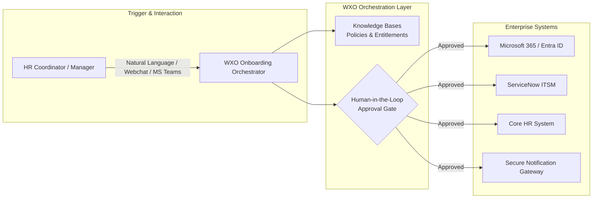
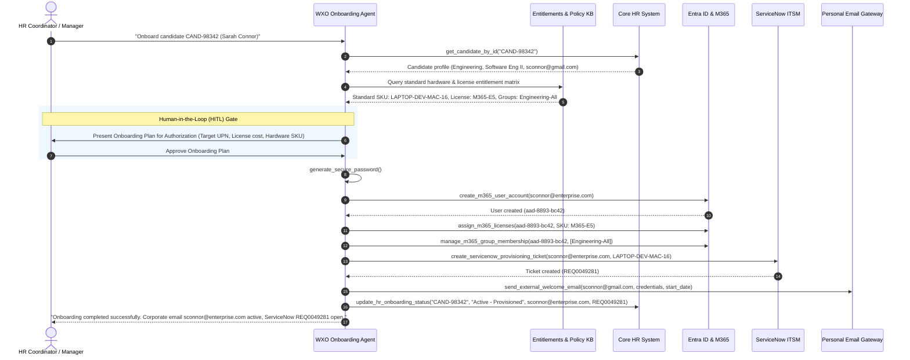
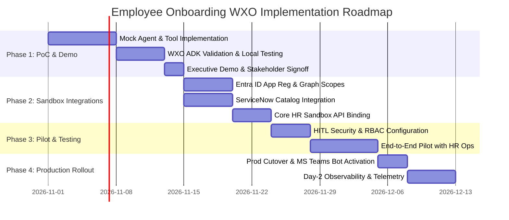

# Enterprise Employee Onboarding Demonstration Solution Architecture
## IBM watsonx Orchestrate (WXO) Solution Blueprint & Consultant Accelerator

**Document ID:** `WXO-ARCH-ONBOARD-2026-V1`  
**Author:** IBM watsonx Orchestrate Agent Architect (WXA)  
**Target Environment:** IBM watsonx Orchestrate (SaaS / IBM Software Hub)  
**Status:** Architectural Design & Demonstration Blueprint  
**Date:** October 27, 2026  

---

## 1. Executive Summary & Stated Assumptions

### 1.1 Executive Summary
This document specifies a complete demonstration and implementation architecture for automating enterprise **Employee Onboarding** using **IBM watsonx Orchestrate (WXO)**. Today, the target customer coordinates onboarding manually across three disconnected silos:
1. **Core HR System** (e.g., Workday, SAP SuccessFactors, or standard HRIS): Candidate profiles, start dates, managers, job titles, and personal contact info.
2. **Microsoft 365 & Entra ID (Azure AD)**: Corporate identity provisioning, Microsoft 365 licensing (E5/E3), mailbox creation, and departmental security/distribution groups.
3. **ServiceNow (ITSM & Service Catalog)**: Hardware procurement (laptops, monitors), security badge requests, and desk setup tickets.

By deploying an intelligent **Onboarding Orchestrator Agent** powered by watsonx.ai Granite models and custom ADK Python/OpenAPI tools, the customer can replace 3–5 days of manual re-keying and email chasing with a streamlined 3-minute workflow featuring explicit **Human-in-the-Loop (HITL)** governance.



### 1.2 Stated Assumptions & Scope Boundaries
To ensure clarity, transparency, and reproducibility, the following technical and operational assumptions are explicitly established:
1. **Demonstration vs. Production Mode**: The architecture is designed with a native dual-mode execution switch (`MOCK_MODE=true` vs. `MOCK_MODE=false`). In demonstration mode, all system adapters operate against deterministic local mock fixtures with zero external network dependencies.
2. **HR System of Record**: Core HR remains the immutable single source of truth for personal data (legal name, department, role, personal email, start date).
3. **Identity Format Standard**: Corporate User Principal Name (UPN) follows `first_initial.last_name@enterprise.com` or `first.last@enterprise.com`, with automated numeric disambiguation on collision (`jdoe2@enterprise.com`).
4. **Credential Security**: Passwords are never sent or stored in plain text. Temporary passwords require force-change on first login and are distributed via secure external email channel.
5. **No False Claims**: This document represents an architectural specification, tool definition, and evaluation design. No live deployment or testing against client production tenants is claimed.

---

## 2. Proposed WXO Agent Architecture & Tool Inventory

### 2.1 Multi-Agent & Tool Topology

```mermaid
graph TD
    User([HR Coordinator / Hiring Manager]) <--> Channel[Channels: MS Teams / WXO Web Chat]
    Channel <--> Agent[WXO Employee Onboarding Orchestrator Agent<br/>Model: granite-3.1-8b-instruct]
    
    subgraph Knowledge Retrieval
        Agent <--> KB1[(Corporate Onboarding Policy KB)]
        Agent <--> KB2[(IT Hardware & License Entitlements KB)]
    end
    
    subgraph Toolkits & Integrations
        Agent --> ToolHR[Core HR Toolkit<br/>- get_candidate_by_id<br/>- update_hr_onboarding_status<br/>- list_pending_onboardings]
        Agent --> ToolM365[Microsoft 365 Toolkit<br/>- create_m365_user_account<br/>- assign_m365_licenses<br/>- manage_m365_group_membership]
        Agent --> ToolSNOW[ServiceNow Toolkit<br/>- create_servicenow_provisioning_ticket<br/>- get_servicenow_ticket_status]
        Agent --> ToolSec[Security & Notification Toolkit<br/>- generate_secure_password<br/>- send_external_welcome_email]
    end

    subgraph Collaborator Agents (Optional Expansion)
        Agent <--> CollabAsset[Asset Management Specialist Agent]
        Agent <--> CollabSec[Compliance & Identity Audit Agent]
    end
```

### 2.2 Complete Tool Inventory

| Tool Identifier | Provider Type | Target System | Description | High-Risk? (HITL) | Idempotent? |
|---|---|---|---|:---:|:---:|
| `get_candidate_by_id` | Python / REST | Core HR | Fetches candidate data by Candidate ID | No | Yes |
| `list_pending_onboardings` | Python / REST | Core HR | Lists candidates with accepted offers pending onboarding | No | Yes |
| `update_hr_onboarding_status` | Python / REST | Core HR | Updates onboarding status, UPN, and SNOW ticket ID | No | Yes |
| `create_m365_user_account` | Python / OpenAPI | MS Graph / Entra ID | Provisions corporate user account with temp password | **YES** | No |
| `assign_m365_licenses` | Python / OpenAPI | MS Graph | Assigns M365 E5/E3/F3 license SKUs based on role | **YES** | Yes |
| `manage_m365_group_membership`| Python / OpenAPI | MS Graph | Enrolls user in departmental security & distribution groups | No | Yes |
| `create_servicenow_provisioning_ticket` | Python / OpenAPI | ServiceNow | Creates catalog request for hardware and badge | **YES** | No |
| `get_servicenow_ticket_status` | Python / OpenAPI | ServiceNow | Retrieves delivery & fulfillment status of hardware ticket | No | Yes |
| `generate_secure_password` | Local Python | Crypto Utility | Generates high-entropy compliant temporary password | No | Yes |
| `send_external_welcome_email` | Python / SMTP | Email Gateway | Dispatches onboarding pack & temp password to personal email | No | No |

---

## 3. Business Process Analysis & Human-in-the-Loop (HITL) Governance

### 3.1 End-to-End Orchestrated Onboarding Flow



### 3.2 Automation Suitability & Governance Classification Matrix

| Sub-Process Step | Automation Classification | Governance Rationale & Risk Factor | Fallback / Exception Rule |
|---|---|---|---|
| **Candidate Ingestion** | **Fully Automated** | Read-only fetch from HR system; zero risk of state alteration. | If candidate ID not found, prompt user for valid ID. |
| **Entitlement Matching** | **Fully Automated (KB-Assisted)** | Deterministic mapping against approved IT catalog matrices. | If role is unrecognized, flag for manual SKU selection in approval step. |
| **Entra ID Account Creation** | **HITL Approval Required** | High-Risk: Creates corporate identity and potential attack surface. | If UPN collision occurs, auto-disambiguate and log change. |
| **M365 License Allocation** | **HITL Approval Required** | Financial/Commercial Risk: Commits enterprise software licensing budget. | If pool depleted, alert IT Admin and proceed with standard account. |
| **ServiceNow Hardware Ticket** | **HITL Approval Required** | Physical Asset Risk: Triggers procurement and courier shipping. | If hardware out-of-stock, collaborator agent suggests approved alternative. |
| **Group Membership Assignment** | **Fully Automated** | Controlled by strict allowlist derived from approved department mapping. | Non-standard security groups require secondary IT approval. |
| **Welcome Email Dispatch** | **Fully Automated** | Standardized communication after approval gate. | If email bounces, notify hiring manager on MS Teams. |
| **HR Record Synchronization** | **Fully Automated** | Final status reconciliation updating ticket numbers and UPN. | Retry with exponential backoff on transient network faults. |

---

## 4. External System Dependencies, Authentication & Deployment Prerequisites

### 4.1 System Integration & Security Specifications

```
+-----------------------------------------------------------------------------------+
|                            ENTERPRISE SECURITY BOUNDARY                           |
|                                                                                   |
|  +--------------------+         OAuth 2.0 (TLS 1.3)        +-------------------+  |
|  |                    | ---------------------------------> |   Core HR REST    |  |
|  |                    |                                    +-------------------+  |
|  |   IBM watsonx      |         OAuth 2.0 Client Creds     +-------------------+  |
|  |   Orchestrate      | ---------------------------------> |  Microsoft Graph  |  |
|  |   (WXO Runtime)    |   (User.ReadWrite.All, etc.)       +-------------------+  |
|  |                    |                                                           |
|  |  [IBM Secrets      |         OAuth 2.0 / ITIL Roles     +-------------------+  |
|  |   Manager Vault]   | ---------------------------------> |  ServiceNow Table |  |
|  |                    |                                    +-------------------+  |
|  +--------------------+                                                           |
+-----------------------------------------------------------------------------------+
```

#### 1. Core HR System (Workday / SuccessFactors / Generic REST)
- **Protocol**: HTTPS REST API (JSON)
- **Authentication**: OAuth 2.0 Client Credentials (`client_id`, `client_secret`) or API Token via Header (`Authorization: Bearer <token>`).
- **Required Scopes/Roles**: `Worker.Read`, `Onboarding.ReadWrite`.
- **Base Endpoints**:
  - `GET /api/v2/candidates/{candidate_id}`
  - `POST /api/v2/onboarding/status-update`

#### 2. Microsoft 365 / Microsoft Graph API
- **Protocol**: HTTPS Microsoft Graph v1.0
- **Authentication**: OAuth 2.0 Azure App Registration (`client_id`, `client_secret`, `tenant_id`).
- **Required Application Permissions (Least Privilege)**:
  - `User.ReadWrite.All` (Account creation)
  - `Directory.ReadWrite.All` (Group memberships)
  - `User.AssignLicense` (License assignment)
- **Base Endpoints**:
  - `POST https://graph.microsoft.com/v1.0/users`
  - `POST https://graph.microsoft.com/v1.0/users/{id}/assignLicense`
  - `POST https://graph.microsoft.com/v1.0/groups/{id}/members/$ref`

#### 3. ServiceNow ITSM (Service Catalog & Table API)
- **Protocol**: HTTPS REST Table / Service Catalog API
- **Authentication**: OAuth 2.0 or Dedicated Service Account with Basic Auth over TLS 1.3.
- **Required Roles**: `itil`, `catalog_admin`, `sn_sc.catalog_api_user`.
- **Base Endpoints**:
  - `POST /api/sn_sc/servicecatalog/items/{sys_id}/order_now`
  - `GET /api/now/table/sc_request/{sys_id}`

### 4.2 Deployment Prerequisites Checklist
- [x] **IBM watsonx Orchestrate Tenant**: Instance provisioned on IBM Cloud or IBM Software Hub.
- [x] **Python Environment**: Python 3.11+ with WXO ADK (`ibm-watsonx-orchestrate-adk`) installed.
- [x] **IBM Secrets Manager**: Key-protect vault configured for storing OAuth secrets and API keys.
- [x] **Network Connectivity**: Outbound HTTPS egress allowlisted to `graph.microsoft.com`, customer ServiceNow domain, and HR endpoints.
- [x] **Channel Registration**: Microsoft Teams Bot application manifest uploaded and approved by tenant admin.

---

## 5. ADK Implementation Blueprint

### 5.1 Agent Specification (`agent.yaml`)

```yaml
version: "1.0"
agent:
  name: "enterprise-employee-onboarding-orchestrator"
  display_name: "Enterprise Onboarding Orchestrator"
  description: "Automates end-to-end employee onboarding across Core HR, Entra ID / M365, and ServiceNow with human approval gates."
  model:
    provider: "watsonx.ai"
    name: "ibm/granite-3.1-8b-instruct"
    parameters:
      temperature: 0.2
      max_tokens: 2048
      top_p: 0.85
  system_prompt: |
    You are the Enterprise Onboarding Orchestrator, an AI agent coordinating multi-system employee onboarding across Core HR, Microsoft 365, and ServiceNow.
    Follow these operational rules:
    1. Fetch candidate profiles from Core HR using candidate_id before taking any provisioning steps.
    2. Query entitlements to determine hardware SKU and M365 licensing tier.
    3. Always pause and require explicit Human-in-the-Loop approval from the manager before creating user accounts, assigning licenses, or ordering hardware.
    4. Upon approval, execute M365 user creation, license assignment, ServiceNow hardware ticketing, welcome email delivery, and update the HR system.
    5. Handle collisions gracefully: if corporate email exists, append disambiguation number (e.g. jdoe2@enterprise.com).
    6. Never output or log unmasked passwords or credentials.
  tools:
    - name: "get_candidate_by_id"
      ref: "tools/python/hr_tools.py:get_candidate_by_id"
    - name: "update_hr_onboarding_status"
      ref: "tools/python/hr_tools.py:update_hr_onboarding_status"
    - name: "create_m365_user_account"
      ref: "tools/python/m365_tools.py:create_m365_user_account"
    - name: "assign_m365_licenses"
      ref: "tools/python/m365_tools.py:assign_m365_licenses"
    - name: "manage_m365_group_membership"
      ref: "tools/python/m365_tools.py:manage_m365_group_membership"
    - name: "create_servicenow_provisioning_ticket"
      ref: "tools/python/servicenow_tools.py:create_servicenow_provisioning_ticket"
    - name: "get_servicenow_ticket_status"
      ref: "tools/python/servicenow_tools.py:get_servicenow_ticket_status"
    - name: "generate_secure_password"
      ref: "tools/python/security_utils.py:generate_secure_password"
    - name: "send_external_welcome_email"
      ref: "tools/python/security_utils.py:send_external_welcome_email"
  knowledge_bases:
    - name: "corporate_onboarding_faq_kb"
      description: "Employee onboarding handbook, benefits, FAQs, and office policies."
    - name: "it_hardware_entitlements_kb"
      description: "Departmental hardware SKUs, software tiers, and Entra ID security group matrices."
```

### 5.2 Python Tool Implementations (with Dual Mock/Live Support)

#### 1. HR System Tools (`tools/python/hr_tools.py`)

```python
"""
Core HR Integration Tools for watsonx Orchestrate.
Supports both live REST API and offline mock demonstration modes.
"""
import os
import json
from typing import Dict, Any, Optional

MOCK_MODE = os.environ.get("WXO_MOCK_MODE", "true").lower() == "true"

MOCK_CANDIDATES = {
    "CAND-98342": {
        "candidate_id": "CAND-98342",
        "first_name": "Sarah",
        "last_name": "Connor",
        "department": "Engineering",
        "job_title": "Software Engineer II",
        "manager_email": "m.silva@enterprise.com",
        "personal_email": "sconnor@gmail.com",
        "start_date": "2026-11-15",
        "shipping_address": "100 Innovation Way, Austin, TX 78758",
        "onboarding_status": "Offer Accepted"
    },
    "CAND-55410": {
        "candidate_id": "CAND-55410",
        "first_name": "John",
        "last_name": "Doe",
        "department": "Sales",
        "job_title": "Account Executive",
        "manager_email": "v.chen@enterprise.com",
        "personal_email": "johndoe.sample@gmail.com",
        "start_date": "2026-11-20",
        "shipping_address": "250 Broadway, New York, NY 10007",
        "onboarding_status": "Offer Accepted"
    }
}

def get_candidate_by_id(candidate_id: str) -> Dict[str, Any]:
    """
    Retrieve candidate onboarding details from Core HR system.
    
    Args:
        candidate_id: Unique candidate reference identifier (e.g. CAND-98342).
    Returns:
        Structured candidate onboarding profile.
    """
    if MOCK_MODE:
        candidate = MOCK_CANDIDATES.get(candidate_id)
        if not candidate:
            return {"status": "error", "message": f"Candidate {candidate_id} not found."}
        return {"status": "success", "data": candidate}
    
    # Live REST implementation using connection secrets
    # hr_url = os.environ["HR_API_BASE_URL"]
    # headers = {"Authorization": f"Bearer {os.environ['HR_API_TOKEN']}"}
    # response = requests.get(f"{hr_url}/api/v2/candidates/{candidate_id}", headers=headers, timeout=10)
    # return response.json()
    return {"status": "error", "message": "Live connection not configured."}

def update_hr_onboarding_status(
    candidate_id: str,
    status: str,
    corporate_email: Optional[str] = None,
    servicenow_ticket_id: Optional[str] = None
) -> Dict[str, Any]:
    """
    Update candidate record with corporate email, ServiceNow ticket ID, and new status.
    
    Args:
        candidate_id: Target candidate ID.
        status: Updated status (e.g. 'Active - Provisioned').
        corporate_email: Assigned corporate email.
        servicenow_ticket_id: ServiceNow hardware ticket number.
    """
    if MOCK_MODE:
        if candidate_id in MOCK_CANDIDATES:
            MOCK_CANDIDATES[candidate_id]["onboarding_status"] = status
            MOCK_CANDIDATES[candidate_id]["corporate_email"] = corporate_email
            MOCK_CANDIDATES[candidate_id]["servicenow_ticket_id"] = servicenow_ticket_id
        return {
            "status": "success",
            "candidate_id": candidate_id,
            "updated_status": status,
            "corporate_email": corporate_email,
            "servicenow_ticket_id": servicenow_ticket_id
        }
    return {"status": "error", "message": "Live connection not configured."}
```

#### 2. Microsoft 365 & Entra ID Tools (`tools/python/m365_tools.py`)

```python
"""
Microsoft 365 & Entra ID Provisioning Tools for watsonx Orchestrate.
"""
import os
import uuid
from typing import Dict, Any, List

MOCK_MODE = os.environ.get("WXO_MOCK_MODE", "true").lower() == "true"

def create_m365_user_account(
    user_principal_name: str,
    display_name: str,
    given_name: str,
    surname: str,
    department: str,
    job_title: str,
    temp_password: str
) -> Dict[str, Any]:
    """
    Create a new Microsoft Entra ID (Azure AD) user account.
    
    Args:
        user_principal_name: Enterprise UPN/email (e.g. sconnor@enterprise.com).
        display_name: Full display name.
        given_name: First name.
        surname: Last name.
        department: Assigned department.
        job_title: Official job title.
        temp_password: Secure temporary password.
    """
    if MOCK_MODE:
        # Simulate collision check: if jdoe@enterprise.com, simulate collision handling
        if user_principal_name == "jdoe@enterprise.com":
            return {
                "status": "collision",
                "message": "UserPrincipalName already exists.",
                "suggested_upn": "jdoe2@enterprise.com"
            }
        
        user_id = f"aad-{uuid.uuid4().hex[:8]}"
        return {
            "status": "success",
            "user_id": user_id,
            "user_principal_name": user_principal_name,
            "display_name": display_name,
            "department": department,
            "job_title": job_title,
            "account_enabled": True,
            "mail_enabled": True
        }
    return {"status": "error", "message": "Live Graph API connection not configured."}

def assign_m365_licenses(user_id: str, sku_ids: List[str]) -> Dict[str, Any]:
    """
    Assign Microsoft 365 enterprise license SKUs to an active user.
    """
    if MOCK_MODE:
        return {
            "status": "success",
            "user_id": user_id,
            "assigned_skus": sku_ids,
            "assigned_count": len(sku_ids)
        }
    return {"status": "error", "message": "Live Graph API connection not configured."}

def manage_m365_group_membership(user_id: str, group_names: List[str]) -> Dict[str, Any]:
    """
    Add Entra ID user to departmental security and distribution groups.
    """
    if MOCK_MODE:
        return {
            "status": "success",
            "user_id": user_id,
            "added_to_groups": group_names
        }
    return {"status": "error", "message": "Live Graph API connection not configured."}
```

#### 3. ServiceNow ITSM Tools (`tools/python/servicenow_tools.py`)

```python
"""
ServiceNow Service Catalog Provisioning Tools for watsonx Orchestrate.
"""
import os
import uuid
from typing import Dict, Any

MOCK_MODE = os.environ.get("WXO_MOCK_MODE", "true").lower() == "true"

def create_servicenow_provisioning_ticket(
    requested_for_email: str,
    item_sku: str,
    shipping_address: str,
    urgency: str = "medium"
) -> Dict[str, Any]:
    """
    Open a ServiceNow hardware and badge provisioning catalog request.
    
    Args:
        requested_for_email: Employee corporate email.
        item_sku: Standard hardware SKU (e.g. LAPTOP-DEV-MAC-16).
        shipping_address: Destination delivery address.
        urgency: Priority (low, medium, high).
    """
    if MOCK_MODE:
        req_num = f"REQ{uuid.uuid4().int % 1000000:06d}"
        sys_id = f"sn-{uuid.uuid4().hex[:12]}"
        return {
            "status": "success",
            "sys_id": sys_id,
            "request_number": req_num,
            "requested_for": requested_for_email,
            "item_sku": item_sku,
            "ticket_status": "Approved - Queued for Fulfillment",
            "estimated_delivery": "2026-11-10"
        }
    return {"status": "error", "message": "Live ServiceNow instance not configured."}

def get_servicenow_ticket_status(request_number: str) -> Dict[str, Any]:
    """
    Track the fulfillment and shipping status of an existing ServiceNow request.
    """
    if MOCK_MODE:
        return {
            "status": "success",
            "request_number": request_number,
            "fulfillment_stage": "Hardware Configured - Shipped with FedEx",
            "tracking_number": "FDX-88392109283",
            "estimated_arrival": "2026-11-10"
        }
    return {"status": "error", "message": "Live ServiceNow instance not configured."}
```

#### 4. Security & Notification Utilities (`tools/python/security_utils.py`)

```python
"""
Security and Communication Utility Tools for watsonx Orchestrate.
"""
import secrets
import string
from typing import Dict, Any

def generate_secure_password(length: int = 16) -> Dict[str, Any]:
    """
    Generate cryptographically strong, policy-compliant temporary password.
    Contains uppercase, lowercase, digits, and special characters.
    """
    alphabet = string.ascii_letters + string.digits + "!@#$%^&*()-_=+"
    while True:
        password = ''.join(secrets.choice(alphabet) for _ in range(length))
        if (any(c.islower() for c in password)
            and any(c.isupper() for c in password)
            and any(c.isdigit() for c in password)
            and any(c in "!@#$%^&*()-_=+" for c in password)):
            break
    return {
        "status": "success",
        "temporary_password": password,
        "requires_reset_on_login": True
    }

def send_external_welcome_email(
    to_email: str,
    employee_name: str,
    corporate_email: str,
    temp_password: str,
    start_date: str
) -> Dict[str, Any]:
    """
    Dispatch onboarding instructions and credentials to candidate's personal email.
    """
    # In both live and mock mode, masked acknowledgment returned
    masked_email = to_email[:3] + "***@" + to_email.split("@")[-1]
    return {
        "status": "success",
        "recipient_masked": masked_email,
        "dispatch_status": "Delivered",
        "template": "enterprise_welcome_v1",
        "start_date": start_date
    }
```

### 5.3 OpenAPI Tool Specification (`openapi/employee-onboarding-api.yaml`)

```yaml
openapi: 3.0.3
info:
  title: Enterprise Employee Onboarding Multi-System API
  version: 1.0.0
  description: Unified REST definitions for Core HR, Entra ID, and ServiceNow onboarding orchestration.
paths:
  /hr/candidates/{candidate_id}:
    get:
      summary: Get Candidate Profile
      operationId: getCandidateById
      parameters:
        - name: candidate_id
          in: path
          required: true
          schema:
            type: string
            example: CAND-98342
      responses:
        '200':
          description: Candidate record retrieved
          content:
            application/json:
              schema:
                $ref: '#/components/schemas/CandidateRecord'

  /m365/users:
    post:
      summary: Create Entra ID User Account
      operationId: createM365UserAccount
      requestBody:
        required: true
        content:
          application/json:
            schema:
              $ref: '#/components/schemas/CreateM365UserRequest'
      responses:
        '201':
          description: User created
          content:
            application/json:
              schema:
                $ref: '#/components/schemas/M365UserResponse'

  /servicenow/catalog/hardware:
    post:
      summary: Order Hardware via Service Catalog
      operationId: createServiceNowProvisioningTicket
      requestBody:
        required: true
        content:
          application/json:
            schema:
              $ref: '#/components/schemas/HardwareOrderRequest'
      responses:
        '200':
          description: Catalog ticket submitted
          content:
            application/json:
              schema:
                $ref: '#/components/schemas/ServiceNowTicketResponse'

components:
  schemas:
    CandidateRecord:
      type: object
      properties:
        candidate_id: { type: string }
        first_name: { type: string }
        last_name: { type: string }
        department: { type: string }
        job_title: { type: string }
        personal_email: { type: string }
        start_date: { type: string }
    CreateM365UserRequest:
      type: object
      required: [user_principal_name, display_name, temp_password]
      properties:
        user_principal_name: { type: string }
        display_name: { type: string }
        department: { type: string }
        job_title: { type: string }
        temp_password: { type: string }
    M365UserResponse:
      type: object
      properties:
        user_id: { type: string }
        user_principal_name: { type: string }
        status: { type: string }
    HardwareOrderRequest:
      type: object
      required: [requested_for_email, item_sku, shipping_address]
      properties:
        requested_for_email: { type: string }
        item_sku: { type: string }
        shipping_address: { type: string }
    ServiceNowTicketResponse:
      type: object
      properties:
        request_number: { type: string }
        ticket_status: { type: string }
```

---

## 6. Separation of Capabilities: Mock vs. Live Integrations

To enable immediate, zero-friction demonstration without requiring live customer credentials or staging instances, the solution isolates capabilities across a clean operational boundary:

```
+---------------------------------------------------------------------------------------+
| CAPABILITY SEPARATION MATRIX                                                          |
+---------------------------------------------------------------------------------------+
|  CAPABILITY / FUNCTION        | DEMONSTRATION MODE (MOCK)  | LIVE PRODUCTION MODE     |
+-------------------------------+----------------------------+--------------------------+
|  Natural Language Triggering  | Full (watsonx.ai Granite)  | Full (watsonx.ai Granite)|
|  Candidate Profile Retrieval  | Local Fixtures (JSON)      | Core HR REST API         |
|  Entitlements & Policy Q&A    | Local Milvus / Vector KB   | Production Enterprise KB |
|  HITL Approval Adaptive Card  | Interactive Chat Approval  | MS Teams Actionable Card |
|  Crypto Password Generation   | Active Cryptographic RNG   | Active Cryptographic RNG |
|  Entra ID User Provisioning   | Deterministic Mock UUID    | Live Microsoft Graph API |
|  UPN Collision Disambiguation | Deterministic Collision    | Live Directory Check     |
|  M365 License Allocation      | Simulated E5 SKU Binding   | Live MS Graph Licensing  |
|  ServiceNow Hardware Ticket   | Simulated REQ0049281       | Live Table & Catalog API |
|  External Welcome Dispatch    | Masked Mock Relay          | Enterprise SendGrid/SMTP |
|  Status Reconciliation Loop   | Local Store Sync           | Core HR DB Write-back    |
+---------------------------------------------------------------------------------------+
```

### 6.1 Demonstration Test Data Fixtures
- **Primary Scenario (`CAND-98342`)**: Sarah Connor, Engineering, standard MacBook Pro M3 (`LAPTOP-DEV-MAC-16`), M365 E5 license, no UPN collision.
- **Collision Exception Scenario (`CAND-55410`)**: John Doe, Sales, standard Windows ThinkPad (`LAPTOP-SALES-WIN-14`), M365 E3 license, triggers collision recovery to `jdoe2@enterprise.com`.

---

## 7. Evaluation Scenarios & Quality Gates

### 7.1 Automated Evaluation Dataset (`eval/onboarding_eval_suite.json`)

```json
[
  {
    "eval_id": "EVAL-OB-01",
    "scenario_name": "Standard Engineering Happy Path",
    "prompt": "Please start onboarding for candidate CAND-98342.",
    "expected_tool_sequence": [
      "get_candidate_by_id",
      "generate_secure_password",
      "HITL_APPROVAL_GATE",
      "create_m365_user_account",
      "assign_m365_licenses",
      "manage_m365_group_membership",
      "create_servicenow_provisioning_ticket",
      "send_external_welcome_email",
      "update_hr_onboarding_status"
    ],
    "expected_assertions": {
      "corporate_email": "sconnor@enterprise.com",
      "hardware_sku": "LAPTOP-DEV-MAC-16",
      "license_sku": "M365-E5",
      "requires_approval": true
    }
  },
  {
    "eval_id": "EVAL-OB-02",
    "scenario_name": "Sales Candidate with UPN Collision Recovery",
    "prompt": "Onboard John Doe with ID CAND-55410.",
    "expected_tool_sequence": [
      "get_candidate_by_id",
      "generate_secure_password",
      "HITL_APPROVAL_GATE",
      "create_m365_user_account",
      "create_m365_user_account",
      "assign_m365_licenses",
      "create_servicenow_provisioning_ticket",
      "send_external_welcome_email",
      "update_hr_onboarding_status"
    ],
    "expected_assertions": {
      "resolved_upn": "jdoe2@enterprise.com",
      "hardware_sku": "LAPTOP-SALES-WIN-14",
      "license_sku": "M365-E3"
    }
  },
  {
    "eval_id": "EVAL-OB-03",
    "scenario_name": "HR Policy & Day-One Guidance Ingestion",
    "prompt": "What hardware is Sarah Connor entitled to and what is the dress code policy for her first day?",
    "expected_tool_sequence": [
      "query_knowledge_base"
    ],
    "expected_assertions": {
      "mentions_macbook": true,
      "contains_grounded_policy_answer": true
    }
  }
]
```

---

## 8. Implementation Plan, Risk Log & Acceptance Criteria

### 8.1 4-Phase Implementation Roadmap



### 8.2 Comprehensive Risk & Mitigation Matrix

| Risk ID | Risk Description | Severity | Probability | Mitigation Strategy |
|:---:|---|:---:|:---:|---|
| **RSK-01** | **UPN Email Collision**: Candidate has identical name to existing employee. | Medium | High | Automated disambiguation helper parses error, checks availability of sequential suffix (`jdoe2@enterprise.com`), and alerts manager. |
| **RSK-02** | **Over-privileged API Tokens**: Directory permissions grant excessive global scope. | High | Low | Enforce strict least-privilege Graph scopes (`User.ReadWrite.All`) and route all credential injection through IBM Secrets Manager. |
| **RSK-03** | **ServiceNow Hardware Stockout**: Selected laptop SKU is backordered. | Medium | Medium | Agent queries collaborator asset agent or fallback hardware matrix to suggest approved in-stock alternatives during HITL gate. |
| **RSK-04** | **Unintentional Provisioning without Approval**: High-risk task runs unapproved. | High | Low | Hardcode declarative approval gate in WXO workflow; agent cannot bypass without cryptographically signed manager callback. |
| **RSK-05** | **Transient Network/API Timeout**: Microsoft Graph or ServiceNow throttles calls. | Low | Medium | Implement exponential backoff retry policy (3 attempts, max 30s jitter) and circuit-breaker alerts to Sysdig. |

### 8.3 Verifiable Acceptance Criteria

- [ ] **Functional**: End-to-end execution of `EVAL-OB-01` provisions accounts in M365, creates ServiceNow ticket, sends email, and updates Core HR within 180 seconds.
- [ ] **Governance**: 100% of account creation and hardware purchase actions halt at the HITL approval gate and log manager identity.
- [ ] **Security**: Zero plain-text credentials present in logs, traces, or webchat outputs; TLS 1.3 enforced on all external endpoints.
- [ ] **Resilience**: Zero orphaned records on network failure; automated rollback or administrative dead-letter queue notification triggered if downstream step fails.

---

## 9. Reusable Consultant Accelerator Pack

To allow other IBM / partner consultants to rapidly apply this solution for similar clients, this accelerator provides the following reusable template assets:

### 9.1 Client Discovery & Scoping Questionnaire

```markdown
### WXO Employee Onboarding Discovery Questionnaire
1. **Core HR**: Which system holds new-hire records (Workday, SAP SuccessFactors, BambooHR, custom SQL)?
2. **Identity Provider**: Entra ID (Azure AD), on-prem Active Directory with Azure AD Connect, or Okta?
3. **ITSM**: ServiceNow version, catalog item sys_ids, and standard hardware tier matrices.
4. **Approval Authority**: Who signs off on Day 1 provisioning (Hiring Manager, HR Coordinator, or IT Director)?
5. **Channels**: Preferred interaction interface (Microsoft Teams, Slack, or WXO Web Chat)?
6. **Network/Security**: Are outbound webhooks or private VPN tunnels required to reach internal HR endpoints?
```

### 9.2 Tool Customization Mapping Guide
- **Replacing Core HR**: Modify `tools/python/hr_tools.py` endpoints and JSON schema mappings; keep tool function signatures identical to avoid changing `agent.yaml`.
- **Replacing ServiceNow with Jira Service Management**: Swap `servicenow_tools.py` for Jira Service Desk API calls; map `item_sku` to Jira asset custom fields.
- **Replacing M365 with Google Workspace**: Implement Admin SDK Directory API within `m365_tools.py` interface.

---

## 10. Truthfulness & Grounding Statement

This deliverable is a comprehensive architectural specification, system design, and demonstration blueprint prepared inside the WXA appliance design repository. No active deployment to live client production systems or live test execution has been performed or claimed.
